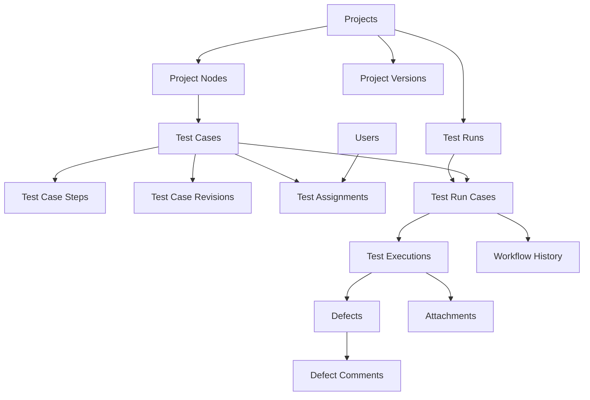

# سند جامع تولید سامانه مدیریت تست نرم‌افزار با هوش مصنوعی

> **نوع سند:** مشخصات اجرایی (SRS + Architecture + Database + Workflow + Implementation Plan + Acceptance Tests)
>
> **نسخه:** 1.0 | **زبان رابط:** فارسی، RTL | **مخاطب:** عامل کدنویس هوش مصنوعی که باید پروژه را صفر تا صد تولید کند.
>
> **هدف:** ساخت یک سامانه تحت وب سبک برای حداکثر ۵ کاربر فعال هم‌زمان یا تعریف‌شده، جهت مدیریت تست دستی نرم‌افزارهای تولیدشده با AI و انتشار روی هاست اشتراکی ایرانی cPanel.

---

## 0. دستورالعمل قطعی برای عامل هوش مصنوعی

شما مسئول **پیاده‌سازی کامل و قابل استقرار** این سامانه هستید، نه صرفاً تولید اسکلت، نمونه رابط کاربری یا شبه‌کد. تمام فایل‌های لازم شامل کد، migration، seed، تست‌ها، نمونه Excel، README فارسی، راهنمای انتشار روی cPanel، فایل نمونه تنظیمات، و اسکریپت‌های لازم را تولید کنید. **هیچ قابلیت ضروری را با TODO، داده نمایشی ثابت، دکمه بدون عملکرد یا API ساختگی جایگزین نکنید.** اگر بخشی به دلیل محدودیت محیط توسعه قابل اجرا نیست، آن را در گزارش تحویل با علت و روش بررسی دستی مشخص کنید. ادعای موفقیت تست بدون اجرای واقعی ممنوع است.

1. قبل از کدنویسی، وضعیت ابزارها، نسخه PHP و افزونه‌ها را بررسی و معماری را با این سند تطبیق دهید.
2. پروژه را مرحله‌ای بسازید؛ پس از هر مرحله، migration، تست و بازبینی انجام دهید.
3. تمام متن‌های UI فارسی و راست‌چین باشند؛ شناسه‌ها، نام کلاس‌ها و جدول‌ها انگلیسی و استاندارد باشند.
4. برنامه باید بدون Node.js، Python، Docker، Redis، queue worker دائمی، SSH و Composer روی **سرور نهایی** اجرا شود. استفاده از Composer، PHPUnit و ابزارهای توسعه فقط روی کامپیوتر محلی مجاز است.
5. امنیت و کنترل دسترسی باید **سمت سرور** اعمال شود. صرفاً پنهان‌کردن دکمه کافی نیست.
6. دیتابیس و برنامه باید واقعی و متصل باشند؛ از mock data فقط در تست‌ها و seed آزمایشی استفاده شود.
7. تمام انتقال‌های وضعیت باید اتمیک، معتبر و ثبت‌شده در تاریخچه باشند.
8. سناریوی تست (Test Case)، اجرای تست (Execution)، خطا (Defect) و وضعیت گردش کار (Workflow State) موجودیت‌های مستقل هستند.
9. برای قابلیت‌های مهم تست خودکار بنویسید. فایل خروجی را با معیارهای پذیرش این سند تطبیق دهید.
10. هر جا سند تصمیمی را صریح تعیین نکرده، ساده‌ترین راه امن و سازگار با هاست اشتراکی را انتخاب کنید و تصمیم را در `docs/DECISIONS.md` ثبت کنید.

### تعریف اتمام (Definition of Done)

پروژه زمانی کامل است که مدیر بتواند پروژه و درخت ماژول‌ها بسازد، کاربران و نقش‌ها را مدیریت کند، سناریو بسازد یا از اکسل وارد کند، سه مسئول تعیین کند، آزمونگر در کارتابل تست کند، خطا به برنامه‌نویس برود، اصلاح برای تست مجدد برگردد، مدیر تأیید/رد نهایی کند، تمام تاریخچه و گزارش‌ها درست ثبت شوند و بسته آماده انتشار روی cPanel همراه با راهنمای بازگردانی بکاپ تحویل داده شود.

---

## 1. محدوده و اصول محصول

### 1.1 مسئله

نرم‌افزارهای دیگری با کمک AI تولید شده‌اند. این سامانه **آن نرم‌افزارها را به شکل خودکار اجرا یا تست نمی‌کند**. سناریوها به افراد محول می‌شوند؛ افراد نرم‌افزار هدف را بیرون از این سامانه به‌صورت دستی بررسی و نتیجه را اینجا ثبت می‌کنند. هدف: شفافیت مسئولیت، رهگیری خطا، تست مجدد، تأیید مدیر و تاریخچه قابل اعتماد.

### 1.2 دامنه نسخه اول (MVP کامل)

- ورود/خروج امن و مدیریت کاربران، نقش‌ها و عضویت پروژه.
- پروژه، نسخه نرم‌افزار، درخت ماژول/زیربخش.
- سناریوی تست با مراحل، پیش‌نیاز، داده تست، نتیجه مورد انتظار، اولویت، دسته‌بندی و سه مسئول اجباری برای سناریوی فعال.
- Import/Export اکسل و CSV با پیش‌نمایش، اعتبارسنجی و گزارش خطا.
- کارتابل مجزا برای آزمونگر، برنامه‌نویس و مدیر پروژه.
- اجرای دستی تست، ثبت Pass/Fail/Blocked، شواهد، خطا، اصلاح و تست مجدد.
- گردش کار دقیق و تاریخچه غیرقابل ویرایش عادی.
- دوره تست (Test Run) و نسخه هدف برای تست رگرسیون.
- داشبورد و گزارش‌های اصلی، فیلتر، جست‌وجو و خروجی.
- اعلان داخلی، تنظیمات، audit log، مدیریت فایل و بکاپ/بازیابی مستند.

### 1.3 خارج از محدوده نسخه اول

اجرای خودکار تست با Selenium/Playwright، تحلیل کد با مدل AI، تولید خودکار سناریو از Prompt، ادغام GitHub، پیامک، ایمیل اجباری، WebSocket، اپ موبایل بومی، API عمومی، SSO، چندمستاجری SaaS، اتوماسیون CI/CD و ابزارهای سنگین گزارش‌گیری. ساختار کد توسعه آتی را مسدود نکند.

### 1.4 مقیاس و عملکرد

- حداکثر ۵ کاربر فعال؛ تعداد پروژه‌ها/سناریوها محدودیت منطقی سخت‌کدشده نداشته باشد.
- هدف اولیه: چند هزار سناریو و چند ده هزار رکورد اجرای تست در یک هاست اشتراکی، **بدون تضمین ظرفیت**؛ با ایندکس و صفحه‌بندی سمت سرور.
- همه لیست‌ها pagination (پیش‌فرض ۲۰، حداکثر ۱۰۰)، فیلتر و جست‌وجوی سمت سرور داشته باشند.
- همه زمان‌ها در DB به UTC ذخیره و در UI به منطقه زمانی `Asia/Tehran` نمایش داده شوند؛ تاریخ فارسی/جلالی در UI ترجیح داده می‌شود ولی تاریخ ورودی/خروجی ماشین باید ISO-8601 باشد.

---

## 2. هاست و انتخاب فناوری

### 2.1 انتخاب پلن از تصویر مرجع

**پلن دوم هاست لینوکس ایران**: ۸۰۰ مگابایت فضا، قیمت درج‌شده ۲۷۰٬۰۰۰ تومان برای سه ماه، هزینه سالانه درج‌شده ۹۶۰٬۰۰۰ تومان. امکانات مشترک مشاهده‌شده: LiteSpeed، PHP/HTML، SSL رایگان، OPcache، پشتیبانی Laravel و ادعای ترافیک داخلی نامحدود. قیمت‌ها و امکانات مربوط به تصویر ارسالی هستند و باید پیش از خرید دوباره تأیید شوند. پلن اول با ۵۰۰ مگابایت در شروع ممکن است جواب دهد ولی برای پیوست‌ها محدودتر است.

**شرط خرید:** نسخه PHP، RAM، CPU، I/O، inode، `memory_limit`، افزونه‌های PHP، امکان Document Root مناسب، محدودیت آپلود و بکاپ از تصویر معلوم نیست. قبل از خرید تأیید شوند. در صورت ناسازگاری، **پلن/هاست را عوض کنید، نه معماری را به شکل ناامن دستکاری کنید**.

### 2.2 پشته فناوری الزام‌آور

| لایه | فناوری |
|---|---|
| Backend | PHP 8.2+ (نسخه سازگار با آخرین نسخه پایدار CodeIgniter 4 انتخاب و قفل شود) |
| Framework | CodeIgniter 4، MVC + Services |
| Database | MySQL یا MariaDB با InnoDB و utf8mb4 |
| Frontend | HTML5، Bootstrap 5 RTL، CSS محلی، JavaScript خالص، Fetch API |
| Charts | Chart.js به صورت فایل محلی |
| Excel | PhpSpreadsheet برای XLSX، CSV با خواننده امن |
| Icons | Bootstrap Icons محلی |
| Auth | Session-based با cookie امن، CSRF و authorization سمت سرور |
| Build | Composer فقط در توسعه؛ `vendor/` داخل بسته انتشار |
| Hosting | LiteSpeed/Apache + cPanel، بدون پردازشگر دائمی |

از React، Next.js، Node.js در production، Python backend، Docker، Redis، RabbitMQ، Elasticsearch، WebSocket، SPA اجباری و سرویس AI در زمان اجرا استفاده نشود. صفحات Server Rendered باشند؛ تعاملات سبک با AJAX اختیاری.

### 2.3 چک‌لیست پیش‌نیاز هاست

- PHP 8.3/8.4 ترجیحی، حداقل نسخه سازگار با نسخه قفل‌شده CodeIgniter.
- `intl`, `mbstring`, `mysqli`/`mysqlnd`, `fileinfo`, `openssl`, `json` و برای XLSX افزونه‌های `zip`, `xml`, `dom`, `simplexml` و سایر وابستگی‌های نسخه قفل‌شده PhpSpreadsheet.
- `memory_limit` ترجیحاً 256MB و حداقل قابل قبول پس از آزمون 128MB.
- `.htaccess`/rewrite، SSL، MySQL/MariaDB، امکان تنظیم upload size و ذخیره private files خارج از `public_html`.
- امکان آپلود ZIP و استخراج، و دسترسی به phpMyAdmin.
- تأیید حد مجاز حجم دیتابیس، تعداد فایل‌ها و I/O.

---

## 3. نقش‌ها و مجوزها

### 3.1 نقش‌های کسب‌وکاری

1. **Tester:** مشاهده موارد محول‌شده، شروع تست، Pass/Fail/Blocked، شواهد، ثبت خطا، Retest.
2. **Developer:** مشاهده خطاهای ارجاع‌شده، توضیح و ثبت اصلاح، نسخه اصلاح‌شده، ارسال برای Retest؛ **نمی‌تواند نتیجه Tester را تغییر دهد**.
3. **Project Manager:** تعریف/مدیریت پروژه، ماژول، سناریو، اعضا، انتساب، نسخه و Test Run؛ تأیید/رد نهایی، بازگشایی با دلیل، گزارش.

**System Admin** یک مجوز سراسری اضافی (نه الزاماً نقش چهارم در تخصیص سناریو) برای مدیریت کاربران، تنظیمات و دسترسی‌ها است. حداقل یک کاربر دارای آن باشد؛ حذف/غیرفعال‌کردن آخرین Admin ممنوع.

### 3.2 قوانین دسترسی

- کاربر فقط پروژه‌هایی را ببیند که در آن عضو است؛ Admin استثنا.
- نقش کاربر می‌تواند در پروژه‌های مختلف متفاوت باشد.
- یک فرد ممکن است در چند پروژه نقش متفاوت داشته باشد؛ برای سناریوی مشخص سه جایگاه Tester/Developer/Manager باید معتبر و دارای نقش متناظر در همان پروژه باشند.
- برای استقلال کنترل کیفیت، در نسخه اول **سه مسئول سناریو باید سه حساب کاربری متمایز باشند**؛ اگر تیم کوچک‌تر بود، این قاعده صرفاً با تصمیم مستند مدیر پروژه قابل تغییر در نسخه آتی است.
- سناریوی `DRAFT` می‌تواند مسئول ناقص داشته باشد؛ خروج از DRAFT به READY تنها با سه مسئول معتبر مجاز است.
- تغییر مسئول بعد از شروع اجرا توسط مدیر مجاز است و باید با دلیل در Audit ثبت شود؛ سوابق اجرا و مسئول قبلی محفوظ بمانند.
- همه درخواست‌ها در سرور هم نقش و هم مالکیت رکورد/پروژه را بررسی کنند؛ از IDOR جلوگیری شود.
- سیاست حذف: حذف فیزیکی داده دارای تاریخچه ممنوع؛ archive/soft-delete و ثبت علت. کاربران دارای سابقه غیرفعال شوند، نه حذف.

### 3.3 ماتریس عملیات

| عملیات | Tester | Developer | Manager | Admin |
|---|---|---|---|---|
| مشاهده سناریوی مربوط | بله | بله | بله | بله |
| ثبت اجرای تست | مسئول سناریو | خیر | فقط در صورت انتساب Tester | مطابق سیاست مدیریت |
| ثبت خطا/شواهد | مسئول Tester | توضیح اصلاح | بله | بله |
| ارسال اصلاح برای Retest | خیر | Developer مسئول | مدیریت استثنا | مدیریت استثنا |
| ساخت/ویرایش پروژه و درخت | خیر | خیر | پروژه خود | همه |
| Import و انتساب | خیر | خیر | پروژه خود | همه |
| تأیید نهایی | خیر | خیر | Manager مسئول | مدیریت استثنا با Audit |
| مدیریت کاربران سراسری | خیر | خیر | خیر | بله |
| گزارش | داده مرتبط | داده مرتبط | پروژه خود | همه |

---

## 4. موجودیت‌های کسب‌وکار و قواعد

### 4.1 Project

فیلدها: `id`, `code` (unique), `name`, `description`, `target_url` (اختیاری)، `status` (`ACTIVE`,`ARCHIVED`), `created_by`, `created_at`, `updated_at`, `archived_at`. لینک هدف صرفاً مرجع اجرای دستی است؛ سامانه به‌طور خودکار به آن متصل نمی‌شود.

### 4.2 ProjectNode (درخت ماژول‌ها)

`id`, `project_id`, `parent_id` nullable, `name`, `description`, `sort_order`, `is_active`, timestamps. کلید خارجی والد، عدم امکان حلقه، عدم انتقال گره به پروژه دیگر، جلوگیری از حذف والد دارای فرزند/سناریو. حداکثر عمق UI پیشنهادی ۴ سطح (با پیام مناسب)؛ ساختار DB از مدل adjacency list `parent_id` استفاده کند. مسیر کامل گره در UI نشان داده شود.

### 4.3 ProjectVersion

`id`, `project_id`, `version_label` (مثلاً v1.2.0), `release_notes`, `target_url`, `released_at`, `created_at`; یکتایی `(project_id, version_label)`. تغییر نسخه نباید نتایج گذشته را تغییر دهد.

### 4.4 TestCase

- `id`, `project_id`, `node_id`, `code`, `title`, `objective`, `preconditions`, `test_data`, `expected_result`, `priority` (`LOW`,`MEDIUM`,`HIGH`,`CRITICAL`), `test_type` (`FUNCTIONAL`,`UI`,`SECURITY`,`REGRESSION`,`OTHER`), `status`, `current_revision`, `created_by`, `updated_by`, timestamps, `archived_at`.
- یکتایی `(project_id, code)`.
- `test_case_steps`: `id`, `test_case_id`, `step_order`, `instruction`, `expected_result` nullable.
- `test_case_revisions`: snapshot غیرقابل‌ویرایش از متن و مراحل، شماره revision، ویرایشگر، دلیل، زمان.
- سناریو دارای تست اجراشده نباید با تغییر متن، معنای سوابق گذشته را عوض کند؛ اجرای تست باید `test_case_revision_id` را ذخیره کند.
- سه مسئول Tester/Developer/Manager در `test_assignments` با `test_case_id`, `tester_id`, `developer_id`, `manager_id`, `assigned_by`, timestamps نگهداری شوند؛ برای MVP یک ردیف جاری به ازای هر سناریو. تاریخچه تغییر انتساب در Audit.

### 4.5 TestRun و TestExecution

- `test_runs`: `id`, `project_id`, `project_version_id`, `name`, `description`, `status` (`OPEN`,`CLOSED`), `created_by`, timestamps.
- `test_run_cases`: `id`, `test_run_id`, `test_case_id`, `test_case_revision_id` (snapshot مرجع در هنگام افزودن)، `added_at`, unique `(test_run_id,test_case_id)`.
- `test_executions`: `id`, `test_run_case_id`, `test_case_revision_id`, `execution_no`, `tester_id`, `result` (`PASS`,`FAIL`,`BLOCKED`), `actual_result`, `notes`, `executed_at`, `created_at`.
- `execution_no` افزایشی برای هر `test_run_case_id`؛ هیچ اجرای قبلی overwrite نشود.
- اجرای سناریو فقط در دوره OPEN مجاز است؛ برای نسخه جدید Test Run جدید ساخته شود.
- وضعیت گردش کار **به ازای آیتم در Test Run** نگهداری شود (فیلد `workflow_status` در `test_run_cases`) تا یک سناریو بتواند در دو دوره وضعیت متفاوت داشته باشد. `test_cases.status` فقط وضعیت تعریف/انتشار (`DRAFT`,`ACTIVE`,`ARCHIVED`) است؛ از به‌کاربردن یک فیلد برای دو مفهوم خودداری کنید.

### 4.6 Defect

`id`, `project_id`, `test_run_case_id`, `execution_id`, `code`, `title`, `description`, `steps_to_reproduce`, `expected_result`, `actual_result`, `severity` (`LOW`,`MEDIUM`,`HIGH`,`CRITICAL`), `status` (`OPEN`,`IN_PROGRESS`,`FIXED_PENDING_RETEST`,`VERIFIED`,`CLOSED`,`REOPENED`), `developer_id`, `reported_by`, `fixed_in_version_id` nullable, `fix_notes`, timestamps. یک execution می‌تواند چند Defect داشته باشد؛ یک Defect در تست‌های مجدد می‌تواند reopen شود. `defect_comments`: نویسنده، متن، زمان؛ تاریخچه کامنت پاک نشود.

### 4.7 Attachments

`id`, `project_id`, `owner_type`, `owner_id`, `original_name`, `stored_name`, `mime_type`, `size_bytes`, `uploaded_by`, `created_at`. `owner_type` فقط مقادیر whitelist (execution/defect/comment). فایل‌ها خارج از Document Root؛ دانلود فقط از کنترلر مجاز. مسیر فایل از ورودی کاربر ساخته نشود.

### 4.8 Notifications و Audit

- `notifications`: `id`, `user_id`, `project_id`, `type`, `title`, `message`, `target_url`, `read_at`, `created_at`؛ هنگام تخصیص، Fail، آماده Retest و انتظار تأیید اعلان داخلی ایجاد شود.
- `workflow_history`: `id`, `test_run_case_id`, `from_status`, `to_status`, `actor_user_id`, `reason`, `created_at`.
- `audit_logs`: `id`, `actor_user_id`, `project_id` nullable, `entity_type`, `entity_id`, `action`, `old_values_json`, `new_values_json`, `ip_address`, `created_at`; اطلاعات حساس (رمز، token، محتوای فایل) ذخیره نشود.
- `import_jobs`: کاربر، پروژه، نام فایل، زمان، تعداد رکورد موفق/ناموفق، وضعیت، گزارش خطا.
- `settings`: کلید/مقدار تنظیمات عمومی؛ اسرار در `.env` نه دیتابیس عمومی.

---

## 5. گردش کار قطعی (Workflow State Machine)

### 5.1 وضعیت‌های آیتم Test Run

| کد | عنوان | اقدام‌کننده |
|---|---|---|
| `READY` | آماده تست | Tester |
| `IN_TEST` | در حال تست | Tester |
| `IN_FIX` | در انتظار اصلاح | Developer |
| `READY_RETEST` | آماده تست مجدد | Tester |
| `BLOCKED` | مسدود | Tester / Manager |
| `PENDING_APPROVAL` | در انتظار تأیید | Manager |
| `APPROVED` | تأیید و بسته‌شده | بایگانی |
| `REJECTED` | رد نهایی | بایگانی |
| `CANCELLED` | لغوشده | بایگانی |

`DRAFT` وضعیت **تعریف سناریو** است، نه وضعیت Test Run. سناریوی DRAFT نباید به Test Run اضافه شود. `FAIL` وضعیت Workflow نیست، بلکه نتیجه Execution است.

### 5.2 انتقال‌های مجاز

| از | رویداد | به | نقش | الزام |
|---|---|---|---|---|
| READY | شروع تست | IN_TEST | Tester مسئول | Test Run باز |
| READY / IN_TEST / READY_RETEST | ثبت PASS | PENDING_APPROVAL | Tester مسئول | ثبت Execution |
| READY / IN_TEST / READY_RETEST | ثبت FAIL | IN_FIX | Tester مسئول | توضیح واقعی + حداقل یک Defect |
| READY / IN_TEST / READY_RETEST | ثبت BLOCKED | BLOCKED | Tester مسئول | دلیل مانع |
| IN_FIX | شروع اصلاح | IN_FIX | Developer مسئول | تغییر Defect به IN_PROGRESS |
| IN_FIX | اعلام رفع | READY_RETEST | Developer مسئول | توضیح اصلاح، ثبت نسخه در صورت وجود |
| BLOCKED | رفع مانع | READY_RETEST | Manager یا Tester مسئول | دلیل رفع مانع |
| PENDING_APPROVAL | تأیید | APPROVED | Manager مسئول | آخرین Execution = PASS |
| PENDING_APPROVAL | درخواست تست مجدد | READY_RETEST | Manager مسئول | دلیل الزامی |
| PENDING_APPROVAL | رد نهایی | REJECTED | Manager مسئول | دلیل الزامی |
| READY / IN_TEST / IN_FIX / READY_RETEST / BLOCKED / PENDING_APPROVAL | لغو | CANCELLED | Manager مسئول | دلیل الزامی |
| APPROVED / REJECTED / CANCELLED | بازگشایی | READY_RETEST | Manager مسئول یا Admin | دلیل الزامی، Audit، Test Run باز |

در حالت `READY_RETEST`، Tester می‌تواند ابتدا به `IN_TEST` برود یا مستقیم نتیجه ثبت کند. اگر بعد از Retest همچنان Fail باشد، Defect موجود قابل بازگشایی است و در صورت مشکل متفاوت Defect جدید ثبت شود. هیچ مسیری نباید بدون بررسی سرور، تاریخچه و تراکنش دیتابیس اجرا شود. **تغییر وضعیت و ثبت Execution/Defect/Notification در یک تراکنش** انجام شود؛ برای جلوگیری از ثبت هم‌زمان دوباره از locking/optimistic concurrency مناسب استفاده شود.

### 5.3 مثال کامل

مدیر پروژه سناریو را می‌سازد و سه مسئول می‌دهد → سناریو ACTIVE می‌شود → در Test Run نسخه 1.0 قرار می‌گیرد و آیتم READY است → Tester تست می‌کند و FAIL ثبت می‌کند → Defect OPEN و وضعیت آیتم IN_FIX می‌شود → Developer رفع و نسخه اصلاح را ثبت می‌کند → READY_RETEST → Tester دوباره تست می‌کند و PASS ثبت می‌کند → PENDING_APPROVAL → Manager تأیید می‌کند → APPROVED. تمام اجراها، Defectها و تغییر وضعیت‌ها باقی می‌مانند.

---

## 6. صفحات و UX فارسی

### 6.1 الزامات عمومی

RTL واقعی، طراحی واکنش‌گرا، فونت فارسی محلی مجاز با رعایت مجوز، تاریخ/عدد قابل فهم، کنتراست مناسب، پیغام خطای واضح، نوار ناوبری و Breadcrumb، فیلتر و صفحه‌بندی. از نمایش اطلاعات فنی سرور به کاربر جلوگیری شود. هیچ وابستگی CDN اجباری نباشد.

### 6.2 صفحات لازم

1. `/login`, `/logout`: فرم ورود، خطاهای امن، خروج، تغییر رمز شخصی.
2. `/dashboard`: داشبورد متناسب با نقش؛ آمار واقعی.
3. `/my-tasks`: کارتابل با تب‌های «نیازمند اقدام»، «در انتظار دیگران»، «تمام‌شده»، فیلتر پروژه/اولویت/وضعیت، جست‌وجو.
4. `/projects`: فهرست، ساخت، ویرایش، بایگانی.
5. `/projects/{id}/tree`: درخت ماژول و زیربخش؛ افزودن، ویرایش، تغییر ترتیب، انتقال ایمن.
6. `/projects/{id}/members`: افزودن عضو و نقش پروژه.
7. `/projects/{id}/versions`: نسخه‌های نرم‌افزار.
8. `/test-cases`: لیست، فیلتر، ساخت، ویرایش، مشاهده تاریخچه و انتساب.
9. `/test-cases/{id}`: جزئیات، مراحل، داده‌ها، نتیجه مورد انتظار، مسئولان، تاریخچه revision.
10. `/test-runs`: ایجاد دوره، افزودن سناریوهای ACTIVE، انتخاب نسخه، مشاهده آیتم‌ها و بستن دوره.
11. `/test-runs/{runId}/cases/{itemId}`: صفحه اجرای دستی، ثبت نتیجه، شرح واقعی، فایل و خطا، تاریخچه اجرا و وضعیت.
12. `/defects`: لیست خطاها، جزئیات، کامنت، اصلاح، بازگشایی و شواهد.
13. `/imports`: آپلود، پیش‌نمایش، اعتبارسنجی، تأیید، تاریخچه Import و گزارش خطا.
14. `/reports`: داشبورد پروژه، وضعیت سناریوها، خطاها، بار کاری افراد، روند نسخه‌ها، Export.
15. `/notifications`: اعلان‌ها، علامت‌گذاری خوانده‌شده.
16. `/admin/users`: مدیریت کاربران و فعال/غیرفعال‌کردن.
17. `/admin/settings`: تنظیمات غیرحساس، محدودیت پیوست، راهنمای بکاپ.
18. صفحات خطای 403، 404، 419/CSRF و 500 با پیام فارسی امن.

### 6.3 کارتابل‌ها

- Tester: موارد READY/IN_TEST/READY_RETEST/BLOCKED مرتبط، دکمه شروع، ثبت PASS/FAIL/BLOCKED، پیوست، تاریخچه.
- Developer: IN_FIXهای مربوط، توضیح خطا و شواهد، تغییر Defect، ثبت رفع، ارسال Retest.
- Manager: PENDING_APPROVAL، BLOCKED، تأخیرها، همه وضعیت‌های پروژه و گزارش‌ها؛ تأیید، برگشت، رد و لغو.
- کاربر چندنقشی می‌تواند نقش/پروژه فعال را انتخاب کند؛ شمارش‌ها از DB محاسبه شوند.

---

## 7. Import/Export Excel و CSV

### 7.1 قالب نمونه فایل

یک فایل `templates/test_cases_template.xlsx` با شیت `TestCases` و شیت `Guide` بسازید. ستون‌ها:

`test_code`, `module_path`, `title`, `objective`, `preconditions`, `steps`, `test_data`, `expected_result`, `priority`, `test_type`, `tester_username`, `developer_username`, `manager_username`.

`module_path` مانند `کاربران / ورود`؛ `steps` با خط جدید یا جداکننده مستند وارد شود. نمونه معتبر و راهنمای مقادیر مجاز در شیت Guide باشد.

### 7.2 قواعد Import

- XLSX و CSV، حداکثر پیشنهادی ۲MB و ۲۰۰ ردیف در هر نوبت (قابل تنظیم پس از تست هاست).
- کنترل extension، MIME، signature مناسب، تعداد ردیف، تعداد ستون، متن و طول فیلدها؛ فایل مخرب رد شود.
- فرمول‌های Excel **محاسبه/اجرا نشوند**؛ مقادیر متنی با احتیاط خوانده شوند.
- مرحله اول: آپلود و parse، اعتبارسنجی تمام ردیف‌ها، نمایش پیش‌نمایش و خطای دقیق ردیف/ستون.
- مرحله دوم: تأیید مدیر و ذخیره در تراکنش/بچ‌های کنترل‌شده.
- شناسایی تکرار با `(project_id, test_code)`؛ دو حالت «فقط ایجاد» و «به‌روزرسانی با revision جدید».
- وجود گره مسیر، کاربران فعال، عضویت و نقش مناسب سه مسئول و متمایزبودن حساب‌ها بررسی شود؛ **گره ناشناخته خودکار ساخته نشود** مگر مدیر صریحاً اجازه دهد (در MVP پیش‌فرض: خطا).
- ردیف ناقص وارد نشود؛ سیاست واردکردن: همه یا هیچ برای یک فایل تا ۲۰۰ ردیف، همراه گزارش خطا.
- Import تکراری نباید رکورد ناخواسته بسازد؛ نتیجه عملیات در `import_jobs` ثبت شود.
- هنگام خروجی CSV/XLSX از Formula Injection جلوگیری شود (مقادیر شروع‌شونده با `=`, `+`, `-`, `@` در سلول‌های متنی ایمن‌سازی شوند).
- فایل نمونه، فایل خطا و Export نتایج قابل دانلود باشند.

---

## 8. مدل داده و Migration

### 8.1 جداول الزامی

`users`, `roles`, `user_roles` (در صورت نیاز برای مجوز سراسری), `projects`, `project_members`, `project_nodes`, `project_versions`, `test_cases`, `test_case_steps`, `test_case_revisions`, `test_assignments`, `test_runs`, `test_run_cases`, `test_executions`, `defects`, `defect_comments`, `attachments`, `workflow_history`, `notifications`, `import_jobs`, `audit_logs`, `settings`.

### 8.2 قواعد ساخت

- همه جدول‌ها InnoDB، `utf8mb4`، شناسه BIGINT UNSIGNED AUTO_INCREMENT (یا INT متناسب با سازگاری؛ انتخاب واحد)، timestamps استاندارد.
- Foreign Keyها واقعی و رفتار حذف `RESTRICT` یا `SET NULL` متناسب با حفظ تاریخچه باشد؛ CASCADE برای داده‌های تاریخی حساس ممنوع.
- Unique indexes: `users.username`, `projects.code`, `(project_id,version_label)`, `(project_id,test_case.code)`, `(test_run_id,test_case_id)`, `(test_run_case_id,execution_no)` و موارد لازم.
- Indexهای کارتابل: `test_run_cases.workflow_status`, انتساب‌ها (`tester_id`, `developer_id`, `manager_id`)، `project_id`, `created_at`, `test_runs.status`, `defects.status`.
- همه enumها در کد ثابت و در DB با VARCHAR مناسب و validation مشخص نگهداری شوند تا تغییرات آتی ساده باشد.
- snapshot revision سناریو در Test Execution الزامی است؛ در `test_run_cases` نیز revision پایه ذخیره شود. هنگام اجرای تست در صورت تغییر سناریو، نسخه نمایش‌داده‌شده صریح باشد.
- مدل‌های CodeIgniter با `allowedFields` محدود، Validation Rules، timestamps و soft-delete در موارد مناسب.
- Seed اولیه فقط Admin و نقش‌ها/تنظیمات ضروری؛ رمز اولیه از متغیر محیطی یا مرحله نصب امن و اجبار تغییر رمز. **هیچ رمز ثابت پیش‌فرض در مخزن قرار نگیرد.**

### 8.3 نمونه روابط



---

## 9. گزارش‌ها و فرمول‌ها

گزارش‌ها فقط بر اساس داده واقعی، با فیلتر پروژه/نسخه/دوره/کاربر/بازه زمانی:

1. تعداد کل سناریوهای دوره، اجراشده و اجرا‌نشده.
2. آخرین نتیجه هر آیتم دوره: PASS، FAIL، BLOCKED، بدون اجرا؛ **تعداد دفعات اجرای مجدد نباید تعداد سناریوها را چندبرابر کند**.
3. درصد پوشش اجرا = آیتم‌های دارای حداقل یک Execution / کل آیتم‌های دوره × ۱۰۰.
4. نرخ موفقیت = آیتم‌هایی که آخرین Execution آنها PASS است / آیتم‌های دارای Execution × ۱۰۰.
5. خطاهای باز به تفکیک severity و وضعیت، میانگین مدت اصلاح، خطاهای بازگشایی‌شده.
6. بار کاری هر Tester/Developer، تعداد سناریوهای در انتظار، موارد معوق.
7. روند نسخه‌ها و تست‌های Regression، آمار تأیید نهایی.
8. Export CSV/XLSX با فیلترهای اعمال‌شده.

Chart.js محلی برای نمودارهای ساده استفاده شود. آمار بدون اجرای تست باید صفر/«داده کافی نیست» نمایش داده شود، نه NaN یا درصد ساختگی. در README تعریف تمام KPIها مستند شود.

---

## 10. امنیت و پایداری

- `password_hash` و `password_verify` با Argon2id در صورت پشتیبانی یا bcrypt مناسب؛ عدم ذخیره رمز خام.
- Session سمت سرور؛ session ID پس از ورود rotate؛ cookie با `HttpOnly`, `Secure` روی HTTPS، `SameSite=Lax` یا سیاست مناسب؛ timeout عدم فعالیت.
- CSRF برای همه درخواست‌های تغییر‌دهنده؛ validation و authorization سمت سرور؛ escape خروجی HTML برای XSS.
- Query Builder/Prepared Statements برای جلوگیری از SQL injection.
- Rate limit تلاش ورود با ذخیره‌سازی سبک DB/session، پیام عمومی برای خطای اعتبارنامه؛ ثبت رخداد.
- اعتبارسنجی همه شناسه‌ها و وابستگی پروژه/کاربر؛ جلوگیری از IDOR.
- فایل‌ها خارج از public root، نام تصادفی، whitelist MIME (تصاویر JPEG/PNG/WebP و در صورت نیاز PDF)، کنترل اندازه و محتوای واقعی، جلوگیری از آپلود PHP/SVG اجرایی.
- پیش‌فرض هر پیوست ۲MB، حداکثر ۳ تصویر برای هر اجرای تست؛ در صورت امکان GD برای کوچک‌سازی تصویر.
- محدودیت حجم فایل‌های لاگ و پاکسازی دوره‌ای با cron اختیاری یا عملیات مدیریت امن؛ هیچ فایل اجرایی آپلودشده در پوشه عمومی نباشد.
- تمام رخدادهای حساس Audit شوند؛ log حاوی رمز، کوکی، token و اطلاعات محرمانه نباشد.
- هدرهای امنیتی مناسب و HTTPS اجباری در production؛ خطای فنی عمومی و لاگ داخلی.
- عملیات چندمرحله‌ای دیتابیس با transaction؛ جلوگیری از double submit و وضعیت ناسازگار.
- تاریخچه اجرا/تغییر وضعیت عادی قابل حذف یا ویرایش نباشد.

---

## 11. ساختار کد پیشنهادی

```text
ai-test-manager/
├── app/
│   ├── Config/
│   ├── Controllers/
│   │   ├── Auth/
│   │   ├── Projects/
│   │   ├── TestCases/
│   │   ├── TestRuns/
│   │   ├── Workbench/
│   │   ├── Defects/
│   │   ├── Imports/
│   │   ├── Reports/
│   │   └── Admin/
│   ├── Models/
│   ├── Services/
│   │   ├── WorkflowService.php
│   │   ├── AssignmentService.php
│   │   ├── ExcelImportService.php
│   │   ├── ReportService.php
│   │   └── AttachmentService.php
│   ├── Filters/
│   ├── Database/Migrations/
│   ├── Database/Seeds/
│   ├── Views/
│   └── Language/fa/
├── public/
│   ├── index.php
│   ├── .htaccess
│   └── assets/{css,js,fonts,images}/
├── writable/
├── vendor/
├── tests/
├── templates/
│   └── test_cases_template.xlsx
├── docs/
│   ├── DECISIONS.md
│   ├── DEPLOY_CPANEL_FA.md
│   ├── BACKUP_RESTORE_FA.md
│   └── TEST_REPORT.md
├── composer.json
├── composer.lock
├── env
└── README.md
```

از Service برای Workflow/Import/گزارش‌ها استفاده شود؛ Controllerها نازک باشند. نام‌گذاری PSR-12 و قواعد CodeIgniter رعایت شود. عملیات AJAX و فرم‌های معمول هر دو پاسخ امن و پیام فارسی مناسب داشته باشند.

---

## 12. API و Routeهای ضروری

| روش | مسیر نمونه | عملکرد |
|---|---|---|
| GET/POST | `/login` | ورود |
| POST | `/logout` | خروج |
| GET | `/dashboard` | داشبورد |
| GET | `/my-tasks` | کارتابل |
| GET/POST | `/projects` | فهرست/ایجاد |
| GET/POST | `/projects/{id}/tree` | مشاهده/افزودن گره |
| GET/POST | `/projects/{id}/members` | اعضا |
| GET/POST | `/projects/{id}/versions` | نسخه‌ها |
| GET/POST | `/test-cases` | فهرست/ایجاد |
| GET/POST | `/test-cases/{id}` | جزئیات/ویرایش با مجوز |
| GET/POST | `/test-runs` | فهرست/ایجاد دوره |
| GET | `/test-runs/{id}` | آیتم‌های دوره |
| POST | `/test-runs/{runId}/cases/{itemId}/start` | شروع تست |
| POST | `/test-runs/{runId}/cases/{itemId}/execute` | ثبت نتیجه |
| POST | `/test-runs/{runId}/cases/{itemId}/transition` | انتقال مجاز وضعیت |
| GET/POST | `/defects` | فهرست/ثبت خطا |
| POST | `/defects/{id}/fix` | ثبت اصلاح |
| GET/POST | `/imports` | پیش‌نمایش و Import |
| GET | `/reports` | گزارش |
| GET | `/reports/export` | خروجی |
| GET/POST | `/admin/users` | کاربران |
| GET | `/attachments/{id}/download` | دانلود مجاز |

Routeهای ویرایش/حذف و جزئیات بیشتر مطابق نیاز تکمیل شوند. از روش HTTP درست، CSRF، redirect-after-post و پاسخ 403/404 مناسب استفاده شود. برای transitionها **رویدادهای مشخص** در بدنه درخواست ارسال شوند؛ سرور هیچ `to_status` دلخواهی را بدون State Machine نپذیرد.

---

## 13. استقرار cPanel و بسته تحویل

### 13.1 ساختار ایمن

```text
/home/ACCOUNT/
├── ai-test-manager/
│   ├── app/
│   ├── vendor/
│   ├── writable/
│   └── .env
└── public_html/
    ├── index.php
    ├── .htaccess
    └── assets/
```

ترجیح اول: Document Root دامنه مستقیماً پوشه `public` برنامه باشد. اگر cPanel اجازه نداد، فقط محتویات `public` را به `public_html` منتقل و مسیرهای bootstrap در `index.php` را با توجه به محل واقعی پروژه اصلاح کنید؛ **app، vendor، writable و .env نباید عمومی شوند**.

### 13.2 مراحل انتشار

1. در سیستم توسعه نسخه‌های PHP/Composer و افزونه‌ها را با هاست تطبیق دهید.
2. `composer install --no-dev --optimize-autoloader` روی محیط توسعه سازگار اجرا کنید؛ `vendor/` را بسته‌بندی کنید.
3. تنظیمات production: `CI_ENVIRONMENT=production`، `app.baseURL`، HTTPS، اطلاعات دیتابیس، کلیدهای لازم، log level.
4. دیتابیس و کاربر را در cPanel بسازید؛ حداقل مجوزهای لازم بدهید.
5. فایل‌ها را ZIP/FTP/SFTP آپلود و استخراج کنید؛ دسترسی پوشه‌های writable را امن تنظیم کنید.
6. Migrationها را با روش سازگار با نبود SSH اجرا کنید: **اسکریپت نصب یک‌بارمصرف دارای احراز هویت قوی و حذف فوری** یا import فایل SQL نسخه‌بندی‌شده در phpMyAdmin. ابزار نصب عمومیِ بدون محافظ نسازید.
7. Admin اولیه را از روش امن راه‌اندازی ایجاد و رمز را تغییر دهید.
8. SSL، rewrite، لاگ، آپلود، دانلود خصوصی، ورود و همه انتقال‌های workflow را تست کنید.
9. از فایل‌ها و دیتابیس بکاپ خارج از هاست بگیرید و بازیابی را آزمایش کنید.

### 13.3 بودجه فضای پیشنهادی برای ۸۰۰MB

| مصرف | بودجه |
|---|---:|
| برنامه و vendor | 100MB |
| دیتابیس | 100MB |
| پیوست‌ها | 350MB |
| لاگ و فایل موقت | 50MB |
| فضای احتیاطی | 200MB |

این اعداد تخمینی‌اند؛ با اندازه‌گیری واقعی به‌روز شوند. بکاپ کامل روی همان هاست انباشته نشود. در صورت رشد پیوست‌ها ارتقای پلن توصیه شود.

---

## 14. بکاپ، بازیابی و نگهداری

- راهنمای بکاپ از phpMyAdmin (SQL) و File Manager/FTP (فایل‌های private و تنظیمات امن) تولید شود.
- بکاپ‌های رمزنگاری‌شده یا با دسترسی محدود خارج از هاست نگهداری شوند؛ رمزها داخل مخزن ذخیره نشوند.
- برنامه بازیابی گام‌به‌گام برای دیتابیس، پیوست‌ها و `.env` مستند شود؛ آزمون بازیابی با داده آزمایشی انجام شود.
- حداقل هفته‌ای یک بکاپ کامل در شروع؛ قبل از هر انتشار و Migration بکاپ اضافی؛ برنامه زمان‌بندی به عهده مالک هاست مگر cron مجاز و تأییدشده باشد.
- لاگ‌ها و فایل‌های موقت قابل پاکسازی امن باشند؛ تاریخچه کسب‌وکاری و Audit بدون سیاست نگهداری صریح پاک نشوند.

---

## 15. برنامه پیاده‌سازی مرحله‌ای برای عامل AI

**فاز 1: زیرساخت** — ساخت CodeIgniter، تنظیم محیط، قالب فارسی RTL، login/logout، Session، CSRF، کاربران، Admin، نقش‌ها، تست دسترسی.

**فاز 2: پروژه‌ها** — CRUD پروژه، درخت، اعضا، نقش پروژه، نسخه‌ها، validation و تست عدم ایجاد چرخه.

**فاز 3: سناریوها** — CRUD، مراحل، revision، سه مسئول، قواعد فعال‌سازی، Import/Export با پیش‌نمایش و تست فایل‌های نامعتبر.

**فاز 4: دوره و Workflow** — Test Run، آیتم‌های دوره، کارتابل، Execution، Defect، رفع خطا، Retest، تأیید/رد/لغو، Notification و History؛ تست همه transitionها.

**فاز 5: گزارش و مدیریت** — KPIها، فیلتر، Chart.js، خروجی، پیوست‌ها، Audit، تنظیمات و بهینه‌سازی Query.

**فاز 6: سخت‌سازی و انتشار** — امنیت، تست integration، تست end-to-end سناریوی اصلی، استقرار آزمایشی مشابه cPanel، مستندات، بسته ZIP نهایی.

**خروجی هر فاز:** کد قابل اجرا، migration جدید، تست‌ها، گزارش تست واقعی، فهرست فایل‌های تغییرکرده و دستور اجرای مرحله بعد. قبل از رفتن به فاز بعد، خطاهای فاز جاری رفع شوند.

برآورد اولیه انسانی: حدود ۲۳ تا ۳۵ روز کاری برای توسعه‌دهنده آشنا با PHP و AI؛ صرفاً تخمین، نه تضمین.

---

## 16. تست‌های پذیرش اجباری

| ID | سناریوی پذیرش | نتیجه مورد انتظار |
|---|---|---|
| AT-01 | Admin وارد شود و کاربر جدید بسازد | ورود امن و کاربر ذخیره شود |
| AT-02 | Tester آدرس پروژه غیرعضو را مستقیم باز کند | 403/404 امن، بدون افشای اطلاعات |
| AT-03 | Manager پروژه و درخت ۳سطحی بسازد | ساختار و Breadcrumb صحیح |
| AT-04 | انتقال گره به زیرمجموعه خودش | رد عملیات و عدم ایجاد حلقه |
| AT-05 | سناریو بدون سه مسئول فعال شود | Validation و جلوگیری از فعال‌سازی |
| AT-06 | سناریوی معتبر در Test Run قرار گیرد | آیتم READY در کارتابل Tester |
| AT-07 | Tester نتیجه FAIL با شرح خطا ثبت کند | Execution + Defect + IN_FIX + Notification + History |
| AT-08 | Developer تلاش کند PASS ثبت کند | رد درخواست با 403 |
| AT-09 | Developer اصلاح را ثبت کند | READY_RETEST و اعلان Tester |
| AT-10 | Tester دوباره FAIL ثبت کند | Execution دوم، تاریخچه اول حفظ، Defect reopen یا جدید |
| AT-11 | Tester PASS ثبت کند | PENDING_APPROVAL |
| AT-12 | Manager تأیید کند | APPROVED، بدون حذف تاریخچه |
| AT-13 | Manager سناریو را با دلیل بازگشایی کند | READY_RETEST + Audit |
| AT-14 | Import اکسل معتبر | سناریوها و انتساب‌ها صحیح ایجاد شوند |
| AT-15 | Import با کد تکراری/کاربر نامعتبر | پیش‌نمایش خطا و عدم Import ناقص |
| AT-16 | آپلود فایل PHP با پسوند تصویر | رد فایل، عدم اجرای کد |
| AT-17 | دانلود پیوست پروژه غیرمجاز | 403/404 امن |
| AT-18 | دو درخواست هم‌زمان برای انتقال وضعیت | فقط انتقال معتبر، بدون Execution تکراری |
| AT-19 | گزارش دوره با Retest متعدد | شمارش هر سناریو یک‌بار بر اساس آخرین Execution |
| AT-20 | نسخه جدید Test Run ساخته شود | نتایج دوره قبلی بدون تغییر باقی بمانند |
| AT-21 | بستن Test Run و تلاش برای تست جدید | رد عملیات |
| AT-22 | غیرفعال‌سازی آخرین Admin | رد عملیات |
| AT-23 | CSRF و XSS در فرم‌ها | درخواست نامعتبر رد، خروجی escape شود |
| AT-24 | بکاپ آزمایشی و بازیابی | داده‌ها و پیوست‌ها قابل بازیابی باشند |
| AT-25 | استقرار بدون Composer/Node/SSH در سرور | برنامه با فایل‌های آماده اجرا شود |

تست واحد برای State Machine، سیاست‌های دسترسی، اعتبارسنجی Excel و محاسبات گزارش ضروری است. تست Integration برای DB و تراکنش‌ها ضروری است. یک تست دستی کامل در مرورگر با حساب‌های سه نقش انجام شود.

---

## 17. معیارهای تحویل نهایی

عامل AI باید این موارد را تحویل دهد:

- کد کامل پروژه و فایل `composer.lock`.
- تمام migrationها و seedهای امن.
- فایل قالب XLSX و نمونه CSV.
- فایل‌های static CSS/JS/Icon/Font به‌صورت محلی و بدون وابستگی به CDN.
- تست‌های خودکار و دستور اجرای آن‌ها.
- `README.md` فارسی: پیش‌نیاز، نصب محلی، ساخت دیتابیس، اجرای تست، ورود اولیه امن، مسیر صفحات.
- `docs/DEPLOY_CPANEL_FA.md`: استقرار گام‌به‌گام با/بدون تغییر Document Root.
- `docs/BACKUP_RESTORE_FA.md`: بکاپ و بازیابی واقعی.
- `docs/DECISIONS.md`: تصمیم‌های تکمیلی معماری.
- `docs/TEST_REPORT.md`: تست‌های اجراشده، نتیجه واقعی و موارد باقی‌مانده.
- `env` نمونه بدون رمز واقعی، `.gitignore` امن، بسته انتشار ZIP که `vendor/` را شامل شود و dev dependencies را نداشته باشد.
- عدم وجود TODO در قابلیت‌های الزامی، صفحه نمایشی بی‌عملکرد، رمز ثابت، API mock یا SQL دستی پراکنده در Controller.

### گزارش نهایی عامل AI باید شامل این موارد باشد

1. امکانات واقعاً تکمیل‌شده و مسیرهای استفاده.
2. نحوه اجرای محلی و مشخصات نسخه‌های PHP/DB/Composer.
3. تعداد و نتیجه تست‌های اجراشده (فقط موارد واقعاً اجراشده).
4. محدودیت‌ها و ریسک‌های شناخته‌شده.
5. مراحل دقیق استقرار و بررسی پس از انتشار.
6. هر اختلاف با سند و دلیل فنی آن.

---

## 18. متن شروع پیشنهادی برای ابزار تولید کد AI

> این فایل Markdown مشخصات قطعی پروژه است. کل آن را بخوان و ابتدا برنامه پیاده‌سازی مرحله‌ای، موجودیت‌ها، migrationها، ماتریس دسترسی و State Machine را استخراج کن. سپس فاز ۱ را واقعاً کدنویسی و تست کن و تا تحویل کامل فازهای ۱ تا ۶ پیش برو. محصول باید PHP/CodeIgniter 4 + MySQL + Bootstrap RTL باشد و روی cPanel ایران بدون Node.js، Composer یا SSH در سرور اجرا شود. از Mock، TODO و UI بدون بک‌اند واقعی برای قابلیت‌های الزامی استفاده نکن. برای هر فاز تست و گزارش واقعی بده؛ هیچ تستی را بدون اجرا موفق اعلام نکن. در پایان بسته استقرار، اسناد، migrations، فایل نمونه اکسل و راهنمای بکاپ را تحویل بده.

---

**پایان سند — نسخه 1.0**
